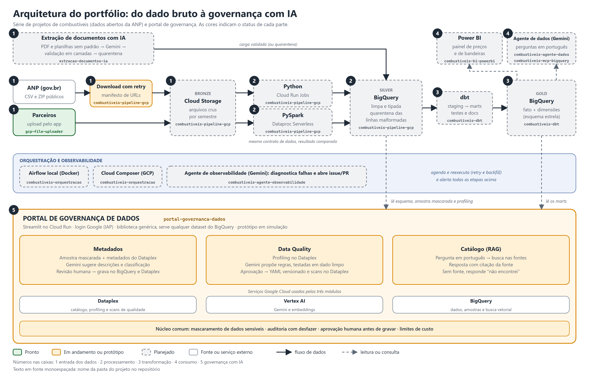

<div align="center">

# 👋 Olá, eu sou o Tancredo

### Engenheiro de Dados · BI · Cloud

*Do dado bruto à decisão: eu construo o caminho entre os dois.*


[💼 LinkedIn](https://br.linkedin.com/in/tancredo-alambert-14a45119) · [✉️ E-mail](mailto:t.alambert@gmail.com) · [🐙 GitHub](https://github.com/Talambert)

</div>

---

## 🧭 Sobre mim

Trabalho com **dados e BI há muitos anos**, e foi nesse tempo que aprendi uma coisa: dashboard bonito não salva dado ruim. Meu trabalho é cuidar de tudo o que vem *antes* da análise, para que quem decide possa confiar no número que está vendo.

- 🏗️ **Construo pipelines e plataformas de dados** que rodam todo dia sem chamar ninguém de madrugada.
- 📊 **Entrego BI de ponta a ponta**: da modelagem ao painel que a diretoria realmente abre.
- ☁️ **Penso em nuvem**, custo e segurança desde o primeiro desenho.
- 🤖 **Uso IA para dar mais valor ao dado.** Já usei o **Vertex AI** para sugerir metadados de tabelas, combinando o que o **Dataplex** já catalogava, uma pequena amostra de dados no **BigQuery** e os metadados existentes, e já criei agentes de IA. Nos projetos abaixo, estou aprofundando esse caminho: servidor MCP, RAG, agentes e, principalmente, **como medir se a IA acerta**.
- 🤝 **Falo a língua do negócio e a da engenharia**, e traduzo uma para a outra.

> 💡 *"Bom dado é aquele em que ninguém precisa perguntar de onde veio."*

---

## 🛠️ Caixa de ferramentas

| Área | O que uso |
|---|---|
| 🐍 **Linguagens** | Python · SQL |
| ☁️ **Cloud** | Google Cloud Platform (BigQuery · Cloud Storage · Dataplex · Vertex AI) |
| 🔄 **Engenharia de dados** | Ingestão · ETL/ELT · Orquestração · Modelagem dimensional |
| 🤖 **IA aplicada a dados** | Vertex AI (Gemini) · Enriquecimento de metadados com Dataplex e BigQuery · Agentes de IA |
| 🗂️ **Governança e catálogo** | Metadados · Catálogo de dados (Dataplex) · Documentação de dados |
| 📈 **BI e visualização** | Dashboards · Modelagem semântica · Storytelling com dados |
| 🧰 **Boas práticas** | Git · Versionamento · Documentação · Segurança de credenciais |

<!-- Ajuste esta tabela com as ferramentas que você realmente quer destacar para recrutadores. -->

---

## 🚀 Projetos

Cada pasta deste repositório é um projeto independente, com o próprio README, e cada um resolve um problema real. Clique para explorar.

| | Projeto | O que faz | Tecnologias | Status |
|:-:|---|---|---|:-:|
| ☁️ | **[GCP File Uploader](gcp-file-uploader/)** | App desktop que permite a qualquer pessoa enviar arquivos para um bucket do Google Cloud Storage com poucos cliques, sem console nem linha de comando. | `Python` `CustomTkinter` `Google Cloud Storage` | ✅ Pronto |
| ⛽ | **[Pipeline de Preços de Combustíveis no GCP](combustiveis-pipeline-gcp/)** | ELT dos dados abertos da ANP até o BigQuery, implementado em **Python (Cloud Run)** e em **PySpark (Dataproc)**, com comparativo de custo e tempo. | `Python` `PySpark` `Cloud Run` `Dataproc` `BigQuery` | 🔨 Em andamento |
| 🧱 | **[Modelagem Dimensional com dbt](combustiveis-dbt/)** | Esquema estrela, testes automáticos e documentação com linhagem sobre os dados de combustíveis. | `dbt` `BigQuery` `SQL` | 🚧 Planejado |
| 🎼 | **[Orquestração com Airflow e Composer](combustiveis-orquestracao/)** | O mesmo DAG rodando no Airflow local e no Cloud Composer, com retries, backfill e alertas. | `Airflow` `Cloud Composer` `Docker` | 🚧 Planejado |
| 📊 | **[Painel de Combustíveis no Power BI](combustiveis-bi-powerbi/)** | Painel sobre o modelo dimensional, que responde onde o combustível está mais caro e quando compensa o etanol. | `Power BI` `DAX` `BigQuery` | 🚧 Planejado |
| 🔌 | **[Servidor MCP para o BigQuery](combustiveis-mcp-bigquery/)** | Camada segura entre IA e dados: somente leitura, limite de custo, autenticação e auditoria de cada consulta. | `MCP` `Python` `BigQuery` `Cloud Run` | 🚧 Planejado |
| 🤖 | **[Agente de Dados com Gemini](combustiveis-agente-dados/)** | Pergunte em português sobre os preços e receba tabela, SQL e custo, com acurácia medida em um conjunto de avaliação. | `Vertex AI` `Gemini` `ADK` `Python` | 🚧 Planejado |
| 🛡️ | **[Agente de Observabilidade de Pipelines](combustiveis-agente-observabilidade/)** | Agente que investiga falhas do Airflow e do dbt, explica a causa provável e propõe a correção em um PR em rascunho para revisão humana. | `Vertex AI` `Gemini` `Airflow` `dbt` | 🚧 Planejado |
| 🛡️ | **[Portal de Governança de Dados](portal-governanca-dados/)** | Portal web e biblioteca **genéricos** para qualquer dataset do BigQuery, com três módulos: sugere metadados, propõe regras de data quality e responde perguntas sobre os dados com citação da fonte (RAG). Usa Dataplex e Gemini, com revisão humana. Roda no Cloud Run. | `Dataplex` `BigQuery` `Vertex AI` `RAG` `Streamlit` `Cloud Run` | 🔨 Protótipo (simulação) |
| 🧾 | **[Extração de Documentos com IA](extracao-documentos-ia/)** | Extrai dados estruturados de PDFs e planilhas sem padrão, valida cada campo e envia o duvidoso para quarentena. | `Vertex AI` `Gemini` `Pydantic` `BigQuery` | 🚧 Planejado |
| 🧩 | **[Biblioteca de Engenharia de Dados (`dataeng-core`)](lib-dataeng-core/)** | Biblioteca Python versionada com o que é comum a qualquer pipeline: ingestão de arquivo, API e Pub/Sub, transformação declarativa (pandas e PySpark), qualidade, SQL parametrizado, montagem de DAG do Airflow e a CLI `dataeng`. | `Python` `pandas` `PySpark` `DuckDB` `Airflow` | 🔨 Implementada e testada local; GCP não validado |
| 🏭 | **[Template de Pipeline (`template-pipeline`)](template-pipeline/)** | Gerador Cookiecutter de repositórios de pipeline (`ingestao`, `relatorio` ou `hibrido`): configuração em YAML, SQL, DAG e testes prontos, com [guia de novo pipeline](template-pipeline/docs/guia-novo-pipeline.md). Roda local de ponta a ponta, sem nuvem. | `Cookiecutter` `Python` `BigQuery` `Cloud Run` `Dataproc` | 🔨 Implementado e testado local; GCP não validado |
| 🔜 | *Próximo projeto* | *Em breve…* | | 🚧 Planejado |

> ⛽ Os projetos `combustiveis-*` formam **uma única história**: do arquivo cru da ANP ao painel de decisão e, depois, a uma IA que responde perguntas sobre os dados com segurança.
>
> 🧩 `lib-dataeng-core` e `template-pipeline` são a **plataforma de templates**: a biblioteca guarda o que se repete entre pipelines e o template gera um repositório novo a partir dela. Foram implementados e testados com a versão local (DuckDB e Pub/Sub em memória); a execução no GCP, no Airflow e no Spark **ainda não foi validada**, e o CI (GitHub Actions) e o `docker build` **nunca foram executados**. O desenho está na [especificação](docs/superpowers/specs/2026-10-19-templates-e-bibliotecas-de-engenharia-design.md).

---

## 🏗️ Arquitetura geral

Como as peças se encaixam, do arquivo cru ao painel e ao portal de governança. As cores mostram o status de cada parte, e o nome em fonte monoespaçada em cada caixa é a **pasta do projeto** neste repositório. O desenho é atualizado conforme os projetos avançam.

[](docs/arquitetura.svg)

<sub>Clique na imagem para abrir a versão vetorial (SVG), que dá zoom sem perder nitidez.</sub>

**Lendo o desenho, da esquerda para a direita:**

1. **Entrada:** os arquivos chegam ao **Cloud Storage (bronze)** por dois caminhos: o *download* dos dados abertos da ANP e o **upload de parceiros** pelo app desktop [gcp-file-uploader](gcp-file-uploader/). Documentos sem padrão (PDF e planilhas) entram por um pipeline próprio de extração com IA, que valida e manda o duvidoso para quarentena.
2. **Processamento:** o mesmo contrato de dados é implementado em **Python (Cloud Run Jobs)** e em **PySpark (Dataproc Serverless)**, gerando a camada **silver** no BigQuery, limpa, tipada e com quarentena das linhas malformadas.
3. **Transformação:** o **dbt** monta o modelo dimensional (fato e dimensões) na camada **gold**, com testes e documentação.
4. **Consumo:** a gold alimenta o painel no **Power BI** e um **agente de dados (Gemini)** que responde perguntas em português por um servidor MCP somente leitura.
5. **Governança com IA:** o **portal de governança** lê o esquema, uma amostra mascarada e o profiling das tabelas e, com Dataplex e Vertex AI, **sugere metadados**, **propõe regras de data quality** (testadas antes de publicar) e **serve o catálogo** com resposta citando a fonte. Nada é gravado sem aprovação humana.

Por baixo de tudo, **Airflow (local) e Cloud Composer** orquestram as etapas, e um **agente de observabilidade** diagnostica falhas do Airflow e do dbt.

---

## 🔎 Em destaque

### ☁️ [GCP File Uploader](gcp-file-uploader/)

> **Problema:** parceiros e clientes precisam enviar arquivos para o nosso Cloud Storage, mas não deveriam precisar de acesso ao console do GCP nem saber usar um terminal.
>
> **Solução:** uma interface simples, com upload via Service Account, que o usuário abre com dois cliques.

- 🖱️ Interface limpa em **CustomTkinter**, compacta e pensada para telas pequenas
- 🔐 **Segurança por padrão**: lista de extensões permitidas e bloqueio de executáveis
- 🧪 **Modo Simulação** para demonstrar o fluxo sem credencial nem bucket reais
- 📦 Empacotável em um **único `.exe`**, sem instalar Python na máquina de quem recebe

**Quer rodar?**

```bash
python -m venv .venv
source .venv/Scripts/activate
pip install -r gcp-file-uploader/requirements.txt
python gcp-file-uploader/src/main.py
```

📖 [Ver documentação completa do projeto →](gcp-file-uploader/README.md)

---

## 🗂️ Como este repositório está organizado

```text
tanc-portifolio/
├── 📁 gcp-file-uploader/            ☁️  Upload de arquivos para o Google Cloud Storage
├── 📁 combustiveis-pipeline-gcp/    ⛽  ELT da ANP até o BigQuery (Python e PySpark)
├── 📁 combustiveis-dbt/             🧱  Modelagem dimensional com dbt
├── 📁 combustiveis-orquestracao/    🎼  Airflow local e Cloud Composer
├── 📁 combustiveis-bi-powerbi/      📊  Painel no Power BI
├── 📁 combustiveis-mcp-bigquery/    🔌  Servidor MCP seguro para o BigQuery
├── 📁 combustiveis-agente-dados/    🤖  Agente de IA (Gemini no Vertex AI)
├── 📁 combustiveis-agente-observabilidade/  🛡️  Agente que diagnostica falhas de pipeline
├── 📁 portal-governanca-dados/      🛡️  Portal de governança: metadados, data quality e catálogo (RAG)
├── 📁 extracao-documentos-ia/       🧾  Extração estruturada de documentos
├── 📁 lib-dataeng-core/             🧩  Biblioteca comum de engenharia de dados (dataeng-core)
├── 📁 template-pipeline/            🏭  Template Cookiecutter de pipelines (ingestao, relatorio, hibrido)
├── 📁 docs/                         🏗️  Diagrama de arquitetura (PNG, SVG e gerador)
├── 📁 planos/                       🗺️  Roadmap e planos de desenvolvimento
└── 📄 README.md                     ← você está aqui
```

Cada projeto é autocontido: tem seu próprio `README.md`, suas dependências e instruções para rodar.

---

## 📬 Vamos conversar?

Se você chegou até aqui, provavelmente temos assuntos em comum: dados, nuvem e transformar informação em resultado. Fico feliz em trocar uma ideia sobre oportunidades, projetos ou só boas práticas de dados.

<div align="center">

[](https://br.linkedin.com/in/tancredo-alambert-14a45119)
[](mailto:t.alambert@gmail.com)

⭐ *Se algo aqui foi útil ou interessante, deixa uma estrela no repositório!*

</div>

<!--
COMO ADICIONAR UM NOVO PROJETO
1. Crie a pasta do projeto na raiz, com README.md próprio.
2. Na tabela "Projetos", troque a linha "Próximo projeto" por:
   | 📊 | **[Nome](pasta/)** | O que faz, em uma frase. | `Tech1` `Tech2` | ✅ Pronto |
   e mantenha uma nova linha "Próximo projeto" no fim.
3. Opcional: crie uma seção em "Em destaque" (problema, solução, 3-4 bullets).
4. Atualize o bloco "Como este repositório está organizado".
-->
